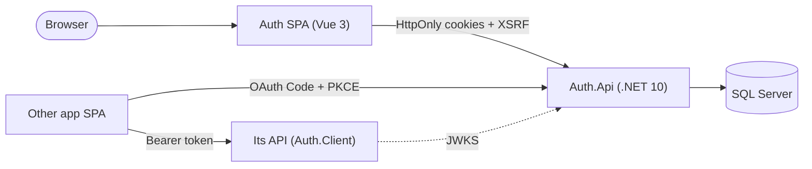

# Central Auth

A central authentication and single sign-on service: an ASP.NET Core (.NET 10) API on SQL Server, and a Vue 3 SPA
for sign-in, registration, MFA and account pages. Other applications connect either with shared-domain cookies or
with OAuth Authorization Code + PKCE, validating tokens through JWKS.

**Features:**

- password sign-in (Argon2id) with lockout and rate limits;
- rotating refresh tokens with reuse detection;
- email verification and password reset;
- TOTP MFA with recovery codes;
- roles and permissions, and an admin API;
- a registry of client applications (CORS and redirect URIs), OAuth Code + PKCE, single logout;
- an audit log with retention;
- an `AddCentralAuth()` library for resource APIs.



## Layout

```
backend/    Auth.sln
  src/        Auth.Api (host, endpoints, middleware) · Auth.Services · Auth.DAL (EF Core, migrations)
              Auth.Entities · Auth.Contracts · Auth.Client (AddCentralAuth for other APIs)
  samples/    Auth.SampleApi: a resource API that trusts Central Auth through JWKS only
  tests/      Auth.UnitTests · Auth.IntegrationTests (SQL Server) · Auth.ArchitectureTests
frontend/   Vue 3 + Vite SPA; examples/consuming-app (OAuth + PKCE client for other apps)
docs/       guides and design notes (below)
```

Dependency rules: Api → Services + Contracts · Services → DAL + Entities + Contracts (no EF) · DAL → Entities.
`Auth.ArchitectureTests` enforces them.

## Quick start

Prerequisites:

- .NET SDK 10.0.x and the `dotnet-ef` tool;
- SQL Server Express (`.\SQLEXPRESS`, Windows authentication) and `sqlcmd`;
- Node.js 24 and npm.

```bash
cd backend && dotnet build Auth.sln && dotnet test Auth.sln
```

Running the API and SPA takes five more steps:

1. create the database (`dotnet ef database update`, with Auth.DAL as the startup project);
2. create the first signing key (a Node script and one SQL insert);
3. set the User Secrets;
4. `dotnet run --project src/Auth.Api --launch-profile https`;
5. `npm ci && npm run dev`, with `VITE_DEV_API_TARGET=https://localhost:7090`.

**Follow [docs/setup.md](docs/setup.md).** It was checked step by step from a clean clone.

## Documentation

| Read this | For |
|---|---|
| [docs/setup.md](docs/setup.md) | local setup from a clean clone, first admin, troubleshooting |
| [docs/architecture.md](docs/architecture.md) | components, layers, request pipeline, sign-in and OAuth sequences (Mermaid) |
| [docs/connect-a-project.md](docs/connect-a-project.md) | connecting another app: shared-domain cookie mode, or OAuth Code + PKCE with a JWKS resource API |
| [docs/deployment.md](docs/deployment.md) | production checklist: reverse proxy, `AllowedHosts` and probes, keys, recommended SPA CSP |
| [docs/threat-model.md](docs/threat-model.md) | assets, trust boundaries, threats and controls, **residual risks** |
| [docs/packages.md](docs/packages.md) | every NuGet and npm package, version and reason |
| [docs/test-matrix.md](docs/test-matrix.md) | security scenarios mapped to the tests that prove them |

Design notes per feature:

- sessions: [sign-in-and-sessions](docs/sign-in-and-sessions.md), [browser-security](docs/browser-security.md),
  [security-headers](docs/security-headers.md), [rate-limiting-and-lockout](docs/rate-limiting-and-lockout.md);
- accounts: [registration-and-email-verification](docs/registration-and-email-verification.md),
  [password-reset-and-change](docs/password-reset-and-change.md), [mfa-totp](docs/mfa-totp.md),
  [mfa-admin-recovery](docs/mfa-admin-recovery.md);
- authorization and admin: [authorization](docs/authorization.md), [admin-api](docs/admin-api.md),
  [audit-and-retention](docs/audit-and-retention.md);
- other apps: [client-applications](docs/client-applications.md),
  [authorization-code-pkce](docs/authorization-code-pkce.md),
  [single-logout-and-shared-domain](docs/single-logout-and-shared-domain.md),
  [t22-client-extension](docs/t22-client-extension.md);
- the SPA: [ui-kit](docs/ui-kit.md), `frontend/README.md`;
- background: [assumptions](docs/assumptions.md), [third-party-data](docs/third-party-data.md).

`backend/src/Auth.Api/appsettings.Example.json` lists every setting the API reads. Committed settings files contain
no secrets; an architecture test enforces this.
