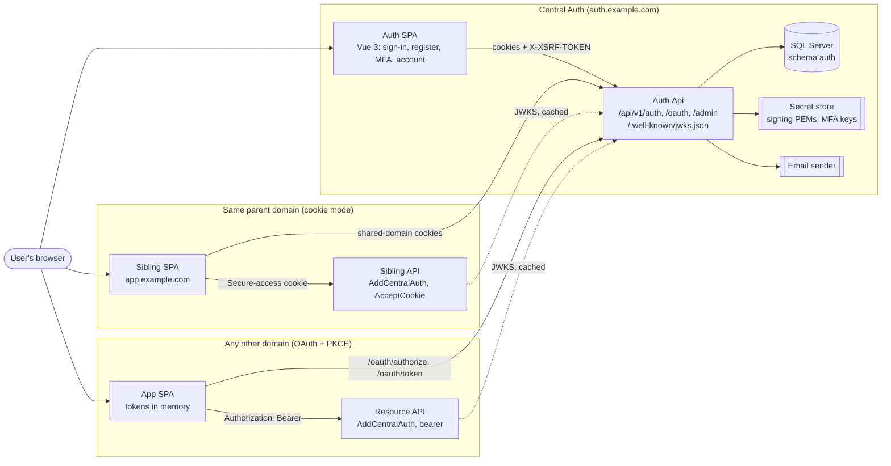
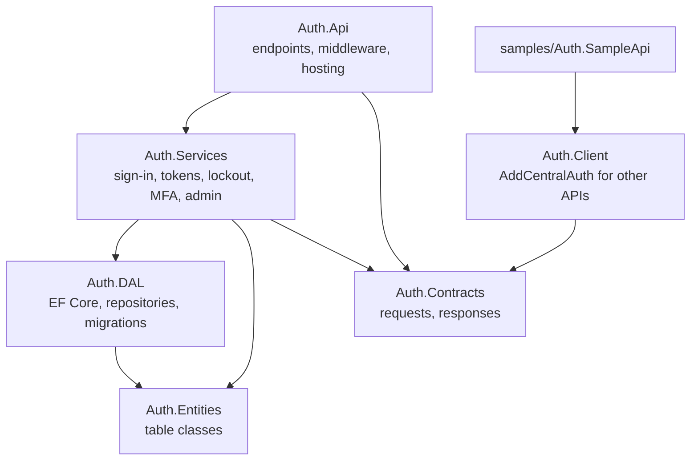
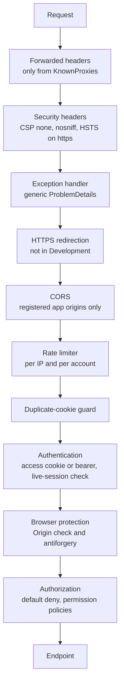
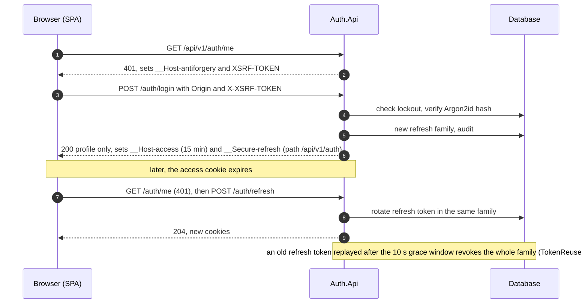
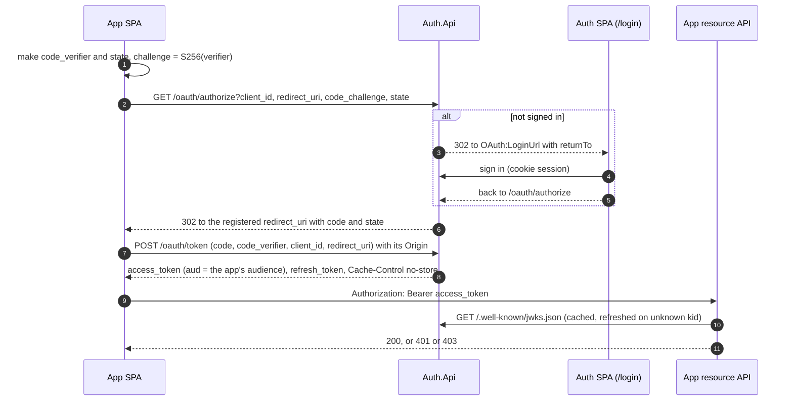

# Architecture

Central Auth is one ASP.NET Core (.NET 10) API on SQL Server, plus a Vue 3 SPA for sign-in and account pages. Other
applications trust it in one of two ways ([connect-a-project.md](connect-a-project.md)):

- **shared-domain cookie mode**, for trusted apps under the same parent domain;
- **OAuth Authorization Code + PKCE**, for apps anywhere else. Their APIs validate bearer tokens against JWKS.

## System context

## Backend layers

- Services never reference EF Core. The DAL keeps EF's compile assets private.
- `Auth.ArchitectureTests` enforces these arrows (NetArchTest).
- Auth.Client has no database and no secret. It needs only the issuer and its JWKS.

## Request pipeline (Auth.Api)

Host filtering (`AllowedHosts`) runs before all of these, on every request.

## Browser sign-in and refresh (the Auth SPA)

No token ever appears in a response body, a URL or `localStorage`.

## OAuth Authorization Code + PKCE (apps on other domains)

- Unknown clients and unregistered redirect URIs get an error page and **never a redirect**.
- Codes are single use, live 1 minute, and are bound to the client, the exact redirect URI and the PKCE challenge.

Details: [authorization-code-pkce.md](authorization-code-pkce.md).

## Data

Thirteen tables in schema `auth`, plus `__EFMigrationsHistory` (`docs/CentralAuth.initial.sql`):

- `User`, `RefreshToken` (hashed values, rotation families), `SigningKey` (public JWKs only);
- `ClientApplication`, `AuthorizationCode`;
- `Role`, `Permission`, `RolePermission`, `UserRole`;
- `EmailVerificationToken`, `PasswordResetToken`, `MfaRecoveryCode`;
- `AuditLog`.

Retention jobs purge expired rows ([audit-and-retention.md](audit-and-retention.md)).

## Where to read more

| Topic | Document |
|---|---|
| Local setup, clean clone | [setup.md](setup.md) |
| Production settings | [deployment.md](deployment.md) |
| Connecting another app | [connect-a-project.md](connect-a-project.md) |
| Threats, controls, residual risks | [threat-model.md](threat-model.md) |
| Sessions, cookies, refresh | [sign-in-and-sessions.md](sign-in-and-sessions.md), [browser-security.md](browser-security.md) |
| Cookie modes, single logout | [single-logout-and-shared-domain.md](single-logout-and-shared-domain.md) |
| Client library | [t22-client-extension.md](t22-client-extension.md) |
| Tests per scenario | [test-matrix.md](test-matrix.md) |
| Packages | [packages.md](packages.md) |
